---
lab:
  title: Create Agents with Copilot Studio
  module: Introduction
  description: In this exercise, you will set up Microsoft Copilot Studio, create agents using templates and natural language, configure agent instructions and knowledge sources, and publish and test an agent.
  duration: 55 minutes
  level: 200
  islab: true
  primarytopics:
    - Microsoft Copilot
    - Microsoft Copilot Studio
---

# Create Agents with Copilot Studio

## Introduction

In this exercise, you will explore Microsoft Copilot Studio by creating agents using templates and natural language. You will define agent behavior through instructions, configure a public website as a knowledge source, and publish and test your agent using the Demo website.

You will use the Power Platform environment and **Lab Exercises** solution prepared in the **ILT Setup** lab. These will serve as the foundation for creating and managing agents throughout the remaining labs.

## What you will learn

- How to create an agent from a template.
- How to create an agent using natural language.
- How to define agent behavior using instructions.
- How to configure public websites as generative AI knowledge sources.
- How to publish and test an agent using the Demo website.
- How environments and solutions organize agent development.

## Prerequisites

- A Microsoft Entra ID account.
- A Copilot Studio license or an active free trial.
- Access to a Power Platform environment with permissions to create agents and related assets.
- The environment and **Lab Exercises** solution created in the **ILT Setup** lab, or an existing environment and solution with equivalent permissions.
- Completion of the **ILT Setup** lab if you do not already have an environment and solution prepared.

## Exercise 0 Create a Power Platform environment

### Task 0.1 - Power Platform Admin Center

Before you start the lab exercises, you must create a development environment for you to work in.

1. Open a web browser and navigate to the **Power Platform admin center** https://admin.powerplatform.microsoft.com/manage/environments. Sign in using the **credentials provided for this lab**.   
1. If prompted, choose the option to stay signed in. Close any pop-up messages that are displayed.

### Task 0.2 - Create a new environment

1. In the sidebar, select **Manage**.
2. On the **Environments** page, select **+ New**.

   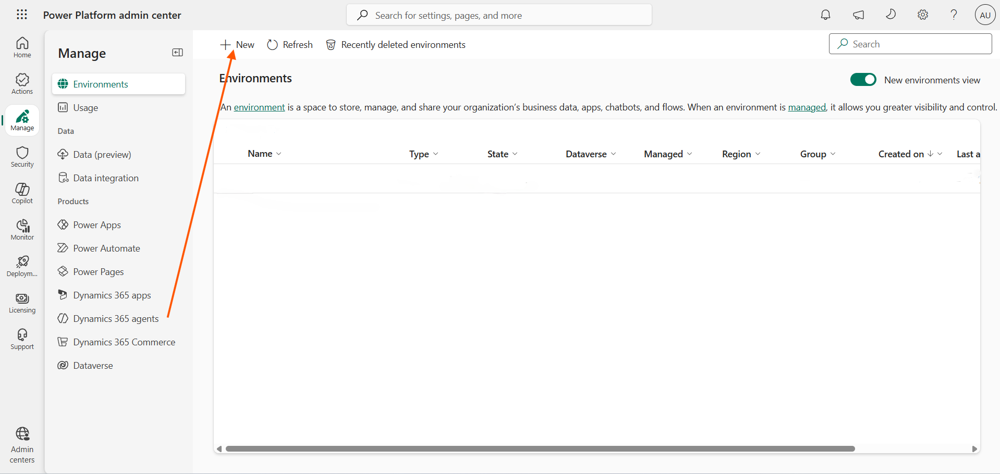

3. In the **New environment** panel, set **Type** to Trial and **Region** to the default region shown (a local region provides quicker data access).

   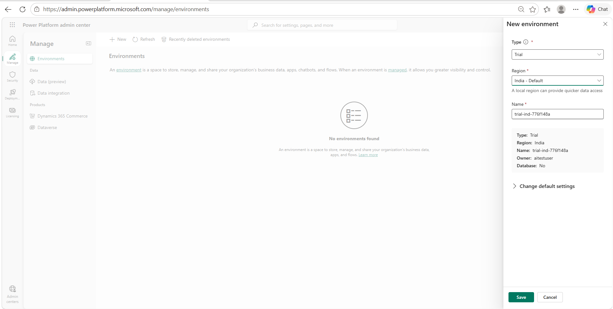
4. Enter your preferred name in the **Name** field.
   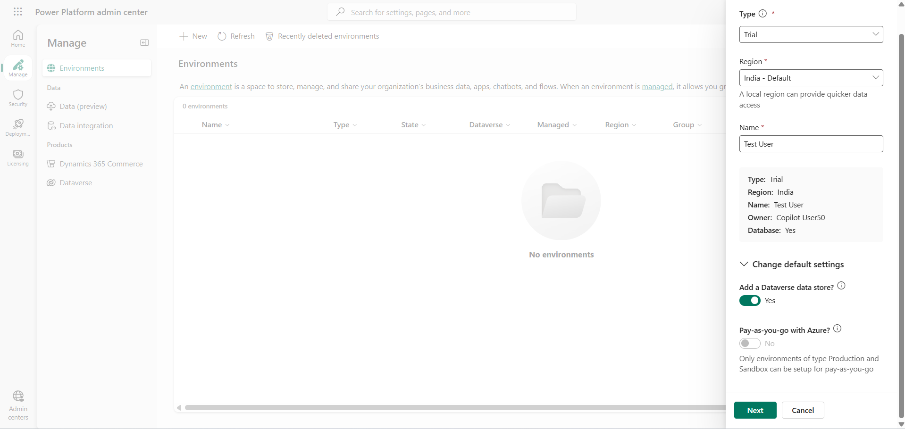
5. Expand **Change default settings**. Under **Add a Dataverse data store?**, select **Yes**.

   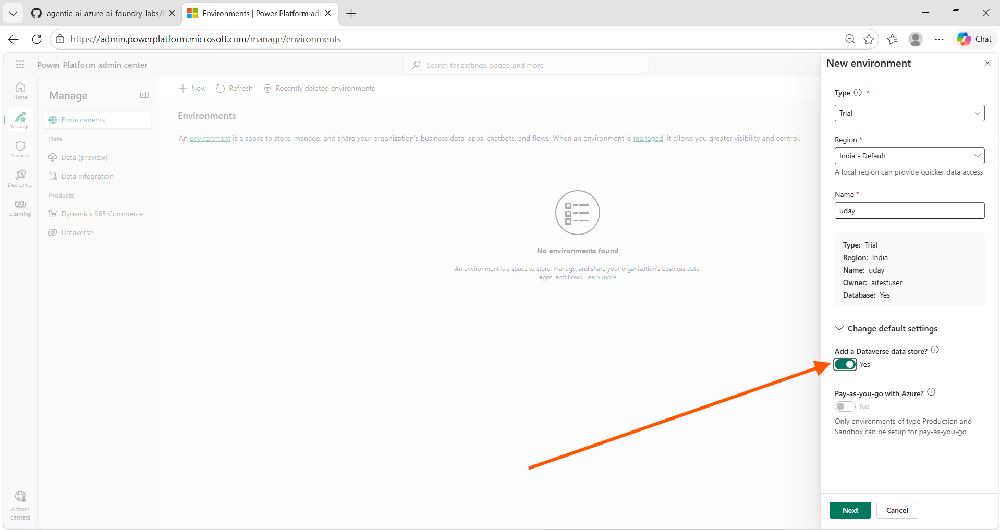

> [!NOTE]
> **Pay-as-you-go with Azure is unavailable for Trial environments. This setting is supported only for Production and Sandbox environments**.

6. Select **Next**. 

7. In the **Add Dataverse** panel, set the following:
   - **Language**: Leave it as **English (United States)** if it is already selected. Otherwise, select **English (United States)** and move to the next field.
   - **Currency**: leave as default
   - **Security group**: Click **+ Select** and in **Edit security group** find **open access** click **None** and Click **Done**
   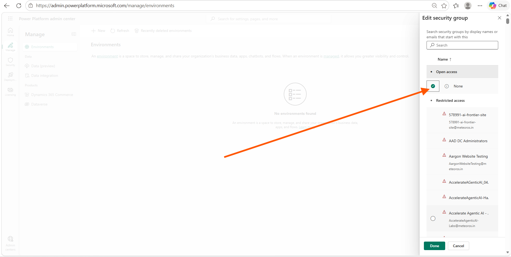
   - **URL**: No changes are required.
   - **Enable Dynamics 365 apps?**: leave as it is (locked to **No**), move to the next field
   - **Deploy sample apps and data?**: No

> [!NOTE]
> **Currency defaults based on your region (for example, INR for India). Enable Dynamics 365 apps is disabled for Trial environments and it's only available for Production or Sandbox environments**.  

   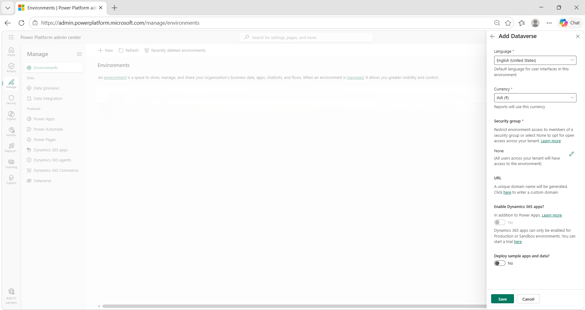

7. Select **Save** and wait for the environment state to change from **Preparing** to **Ready**. After some time, use **Refresh** to update the status.

> [!NOTE]
> **Environment provisioning can take several minutes depending on tenant configuration**.

   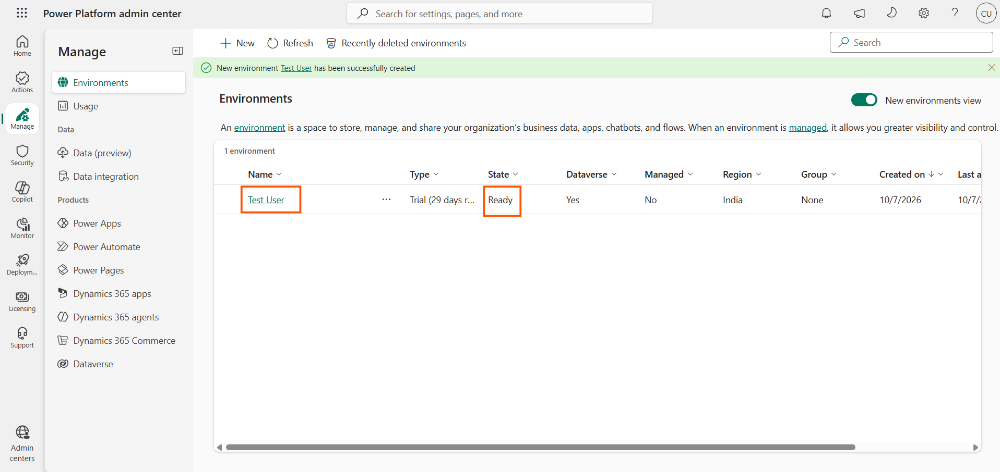

### Task 0.3 - Access Copilot Studio

1. In a new browser tab, open **Copilot Studio** https://copilotstudio.microsoft.com/ and sign in if prompted.

2. You will be redirected to the **new Copilot Studio UI**. This UI has fewer features than the **Classic Experience UI**. We will use the **Classic Experience UI** throughout the labs.

   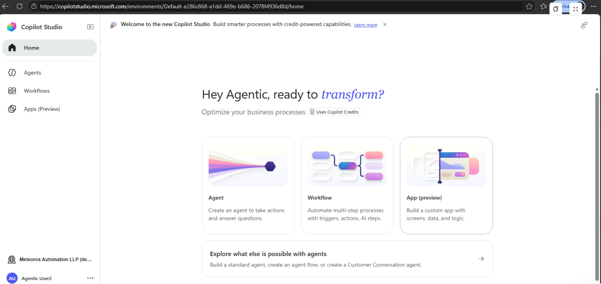

3. Select **...** (More options) at the bottom of the page. Under **Explore**, select **Open Classic Experience**, then select **Skip feedback** and if any setup prompts appear, select Get started and follow the prompts until they are completed. .

   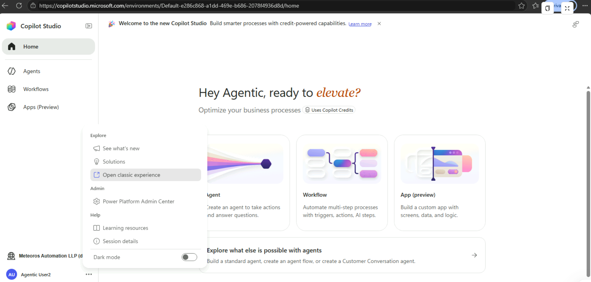

4. Now you are in the **Open Classic Experience**. In the **upper-right corner** of the page, just to the left of the **Settings** ⚙️ icon, locate the **Environment Selector** showing the current environment.

5. Select the **Environment Selector**.

   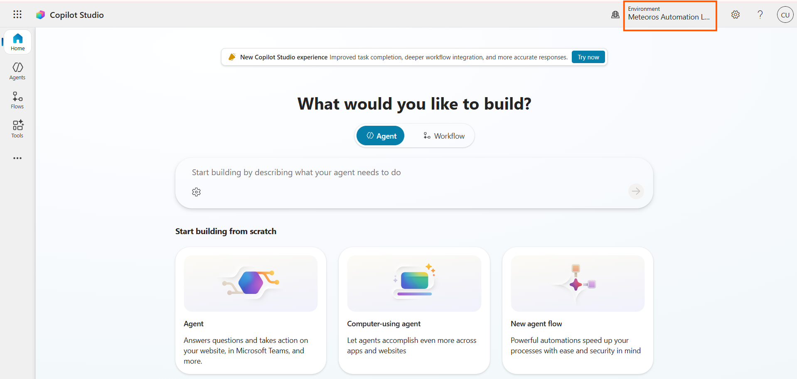

6. The **Select environment** menu will open.

   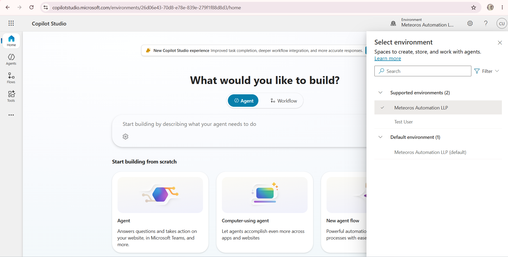

7. Under **Supported environments**, select your **named environment**.

   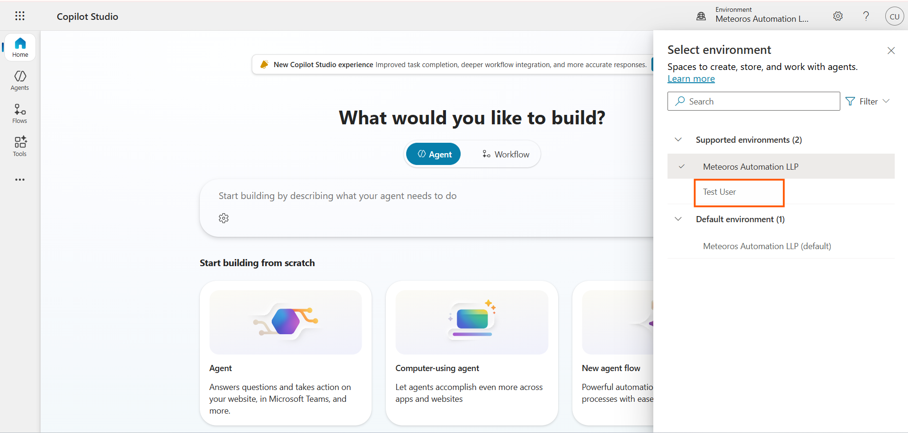

8. Your **named environment** should now be displayed in the **Environment Selector**.

   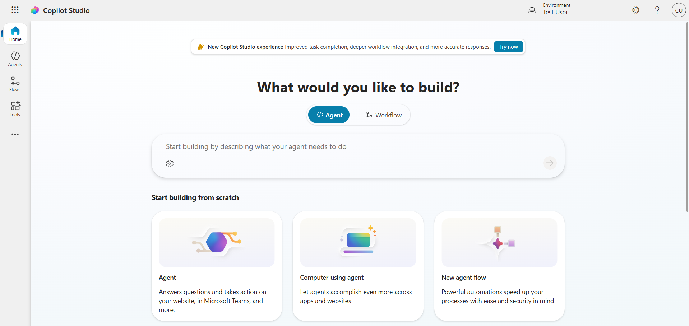

9. You are now in the correct **environment** and the **Classic Experience** UI is ready for the lab.

> [!TIP]
>
> **Remember these steps, as you will use them throughout the labs when you are redirected to the new UI or a different environment.**

### Task 0.4 - Create a solution

1. In the left navigation pane, select the ellipses (**...**), then select **Solutions**.
2. Verify that **Default Solution** and **Common Data Services Default Solution** are listed.

   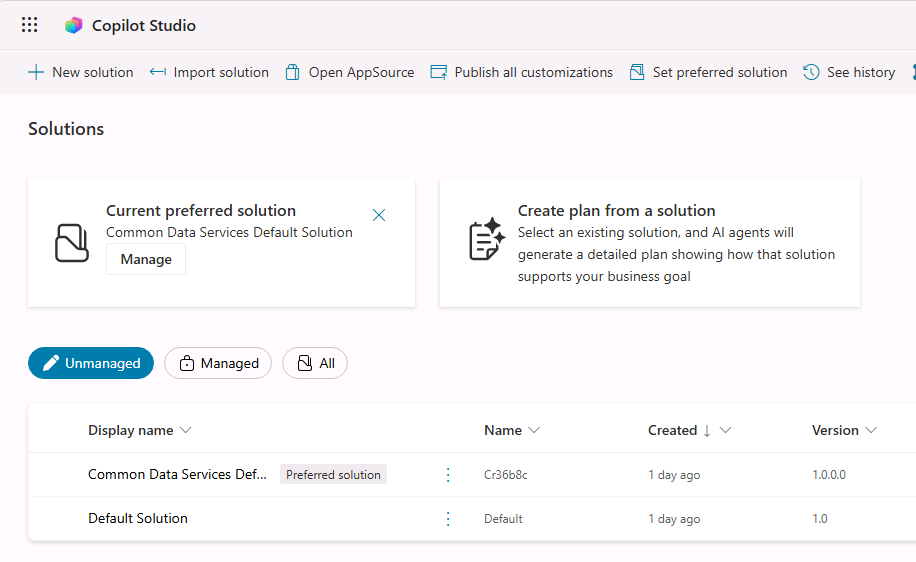

3. Select **+ New solution**.
4. Enter **`Lab Exercises`** in the **Display name** field. The **Name** field should automatically populate as **LabExercises**, with the space removed.
5. Select **+ New publisher** below the **Publisher** drop-down.
6. Enter **`Fabrikam_unique_Suffix`** for Display name, `fabrikam_unique_suffix` for Name, Leave the Description field empty and proceed to the next field, Prefix. Now fill `fab` for Prefix, then select **Save**.

   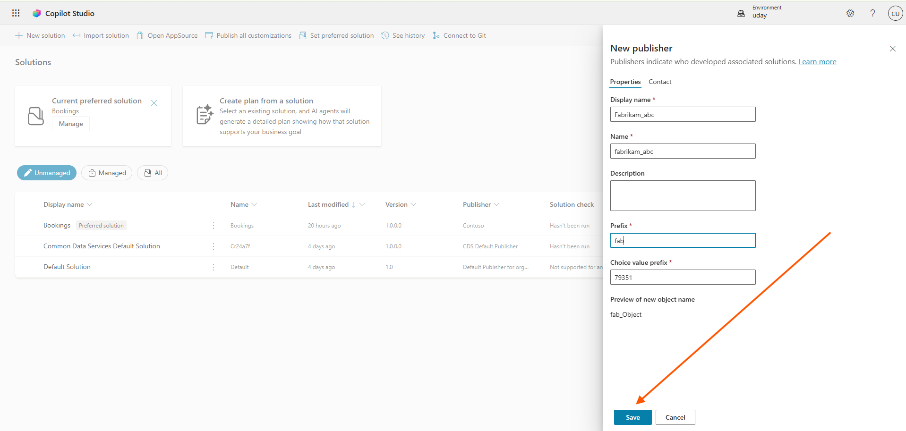
     
7. Confirm **Fabrikam_unique_suffix (fabrikam_unique_suffix)** is selected in the **Publisher** drop-down.
8. Leave **Version** as the default value.
9. Select the **Set as your preferred solution** checkbox.

> [!NOTE]
> Setting this as your preferred solution ensures new assets created during later labs are added to the Lab Exercises solution by default.

10. Select **Create**.

   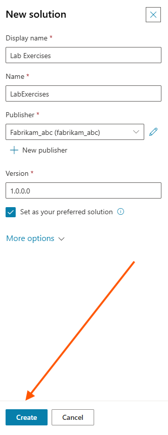

11. Close the **Solutions** browser tab by selecting the **←** icon in the left pane.

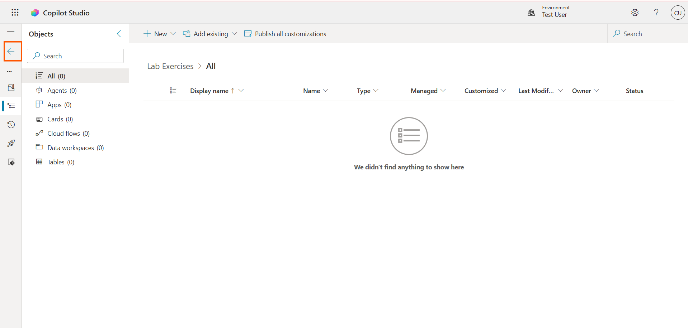

12. You now have a Power Platform environment and solution to work in.

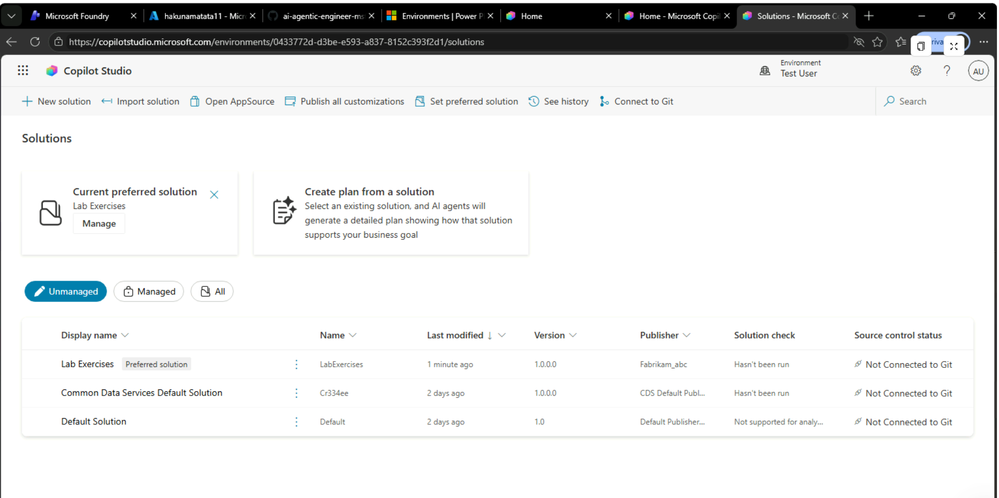

## Exercise 1 - Create an agent from a template

In this exercise, you will create an agent by using a template, and then test the agent.

### Task 1.1 – Create an agent from the Safe Travels template

Open the **Copilot Studio** home page: `https://copilotstudio.microsoft.com/`

> [!IMPORTANT]
> You might notice a new Copilot Studio experience. Some features used in these labs are not available in the new experience, so for these labs use the **Classic Experience**.
>
> The image below shows the **Classic Experience** UI. If your interface looks like this, you're good to go. Continue to the next section. If it looks different, expand the section below and switch back to the **Classic Experience**.
>
> 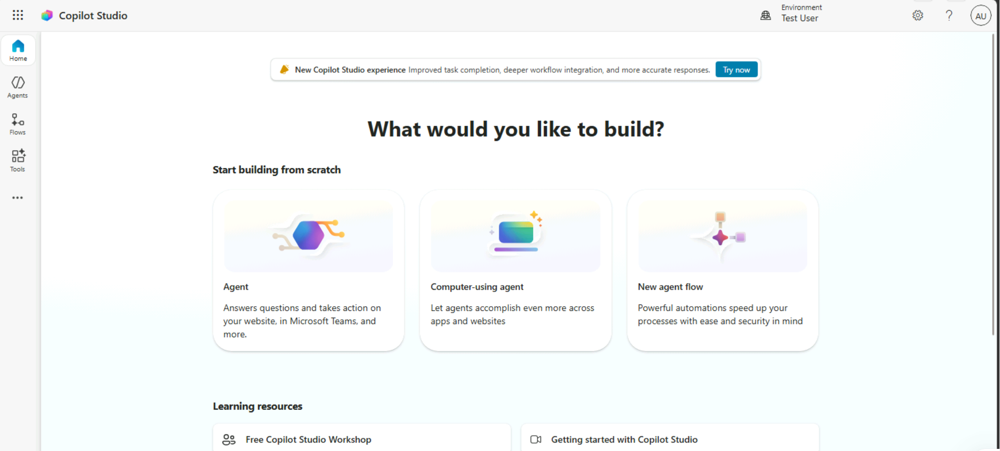
>
> <details>
> <summary>Does your interface look different? Click here</summary>
>
> 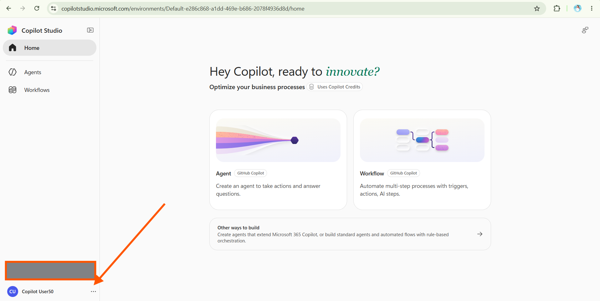
>
> Select **...** (More options) at the bottom of the page. Under **Explore**, select **Open Classic Experience** to switch back to the **Classic Experience**.
>
> </details>

1. In the **upper-right corner** of the page, verify that the **environment you created for this exercise** is selected. If the correct environment is not selected, follow **`Task 1.3 - Access Copilot Studio`** in **`Lab-00-ILT-setup.md`**.

1. Select **Agents** in the left-hand navigation.

1. Under **Start with an agent template** section, select the **Safe Travels** template.

   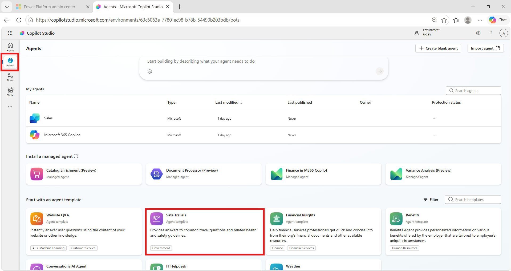

1. In the upper-right of the page, select the ellipses (**...**) and select **Edit advanced settings**.

1. If Solution is already set to **Lab Exercises** and the Schema name already uses the **fab** prefix, select **Cancel**. Otherwise, set **Solution** to **Lab Exercises**, update the **Schema name** to use the **fab prefix**, and select **Save**.

1. In the upper-right of the page, select **Create**.

1. In the **Overview** tab, review the name, description, and agent instructions.

1. Select the **Knowledge** tab and review the public website that has been added as a knowledge source.

1. In the upper-right of the page, select the **Settings** button.

   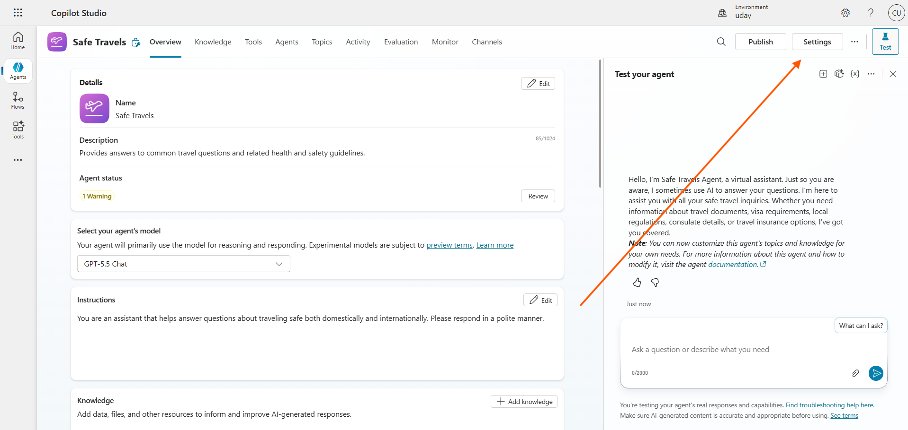

1. Verify that **Orchestration** is set to **No - Use classic orchestration, limiting responses to the content and behavior defined in your agent's topics**.

1. In the upper-right of the Settings page, select **X** icon to close settings.

1. Select the **Topics** tab and select the **System** filter.

   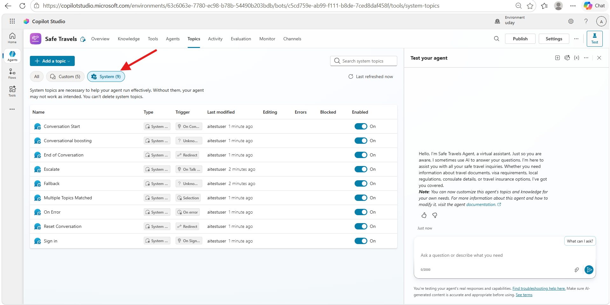

1. Select the **Conversational Start** topic. Review the contents of the **Message** node. The message is displayed in the **Test** pane. The message content may vary slightly. The snippet below is provided for reference.
   
   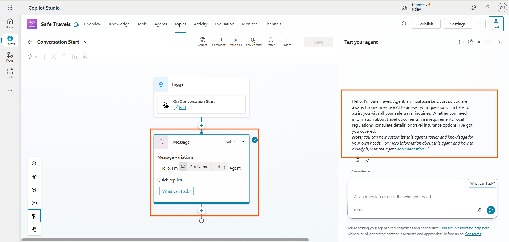

1. In the drop-down in the upper-left of the page that is showing Conversation Start, select the custom **What can I ask** topic.
   
   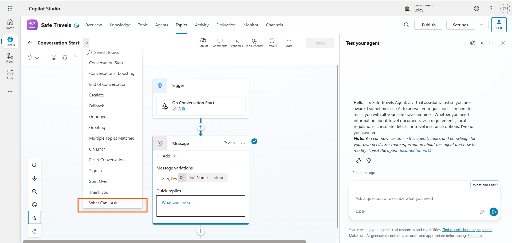 

### Task 1.2 – Test the agent

1. If the **Test** pane is not visible, select the **Test** icon in the upper-right of the page.

1. In the **Test** pane, select the ellipses (**...**) next to the **{x}** icon, then turn **Track between topics** **On**.

   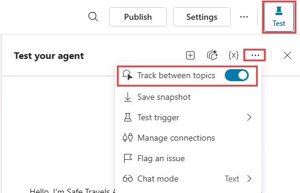

1. Enter the following prompt:

   ```prompt
   Hello
   ```

   The agent will use the default **Greeting** topic and respond with a greeting, typically asking how it can help you. The exact response may vary.

1. At the top of the **Test** pane, select the **Start new test session** icon **+**.

   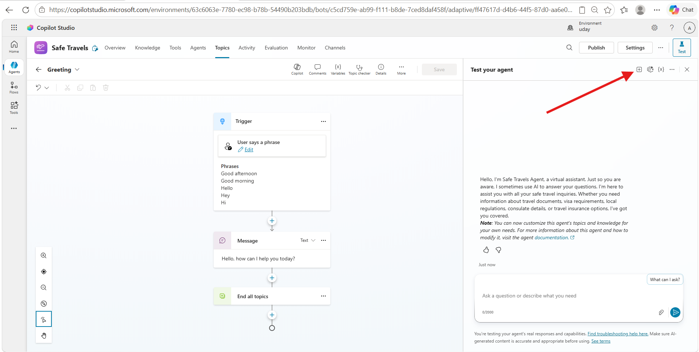

1. Enter the following prompt:

   ```prompt
   What can I ask?
   ```

   The **What Can I Ask** topic will be triggered and present several prompt options to continue the conversation.

1. Select the **How do I get a passport?** option.

   The response may vary slightly from the example shown below. It is generated using the configured knowledge source and may reference the **Conversational boosting** system topic.

   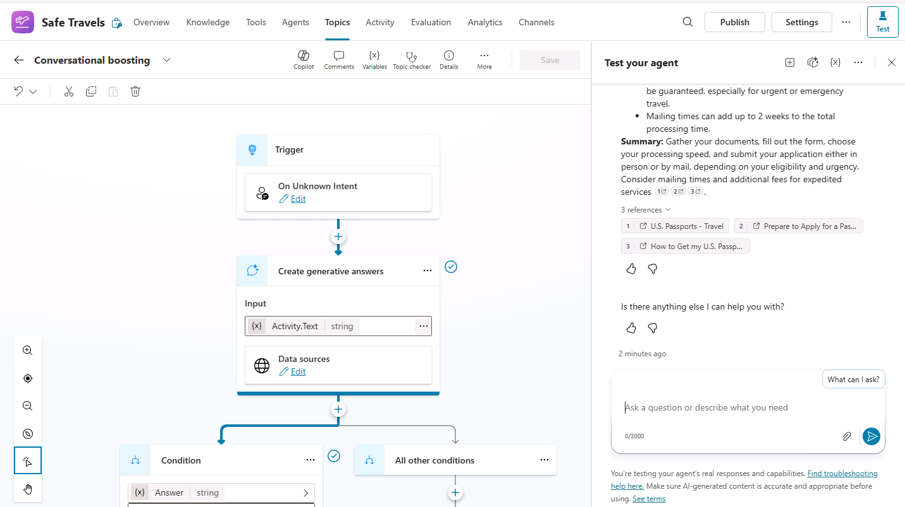

1. Enter the following prompt:

   ```prompt
   What is Copilot Studio?
   ```

   The **Fallback** topic should be selected, and agent should ask you to try rephrasing.

1. Repeat the same prompt two more times. Depending on your environment and orchestration behavior, the agent may trigger the **Fallback** or **Escalate** system topics. You may see a response similar to: **I'm sorry, I'm not sure how to help with that. Can you try rephrasing?**

1. Select **Agents** in the left-hand navigation. The **Safe Travels** agent should be listed.

## Exercise 2 - Create an agent using Copilot

In this exercise, you will create a new agent using natural language to answer questions about government benefits.

### Task 2.1 – Create an agent to answer questions about government benefits

1. In the **Copilot Studio** home page `https://copilotstudio.microsoft.com/`, Verify that you are working in the environment you created earlier and that you are using the **Classic Experience** UI.

1. Select **Agents** in the left-hand navigation.

1. Select **+ Create blank agent**

1. Enter **Benefits Assistant** as the agent name, then click the **Optional** section.

1. Leave **English (United States)** set as the primary language for the agent.

1. In the **Solution** drop-down, select **Lab Exercises**.

1. Enter `govbenefitsagent` for the *Schema name*.

1. Select **Create**.

1. Wait until the agent finishes setting up and the message `This feature isn't available until your agent has finished setting up.` **disappears**.

### Task 2.2 - Configure the Agent

1. In the **Details** section, select **Edit**.

2. Set the following values:

| Setting | Value |
|----------|----------|
| Description | Assists employees with questions about company benefits, leave policies, insurance plans, and other HR-related information. |
| Model | GPT Chat Latest(Oct 2026) |

3. Click Save

4. In the **Instructions** section click edit, enter:

```text
You are a Benefits Assistant that helps employees understand company benefits and HR policies.

Your responsibilities include:
- Answering questions about employee benefits.
- Explaining leave and vacation policies.
- Providing information about health, insurance, and retirement plans.
- Guiding employees to relevant HR resources and documents.
```

5. Click Save

### Task 2.3 – Configure the Overview tab

1. Select the **Overview** tab for the agent.

1. In the **Details** section, select **Edit**.

1. In the **Name** text box, replace the default name with **`US Benefits Assistant`**. If it is already displayed, leave it unchanged and continue to the next step.

1. In the **Description** text box, enter **`Helps users with questions related to US government benefit programs`**.

1. Select **Save**.

1. In the **Select your agent's model** section, select **GPT-5 Auto (Preview)**, if available. Otherwise, select the default recommended GPT model.

1. In the **Instructions** section, select **Edit**.

1. Under *Your Responsibilities Include* in the agent instructions, add the following:

   ```prompt
   - Do not provide legal advice.
   ```

1. Select **Save**.

   > [!NOTE]
   > Agent instructions guide how the agent should behave, but they do not strictly enforce behavior. In later labs, you will learn how to change behavior by using topics, knowledge, and generative answers with restricted knowledge sources.

1. Scroll down to the **Suggested prompts** section, then select **Add suggested prompts**.

1. For **Title**, enter `Health`.

1. For **Prompt**, enter `What health assistance programs are available for me?`.

1. Select **Save**.

### Task 2.4 – Add a public website as a knowledge source

1. Select the **Knowledge** tab.

   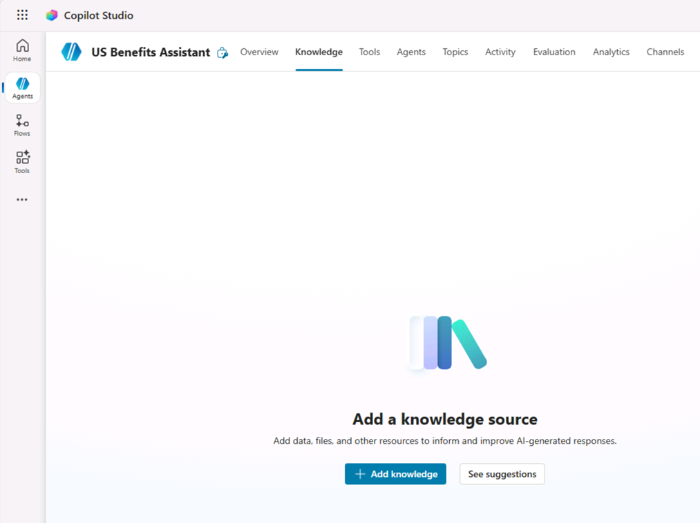

1. Select **+ Add knowledge**.

1. Select **Public websites**.

1. In the **Public website link** text box, enter **`https://www.usa.gov/benefits`**. This official government public website has details on benefits programs that could be useful for your agent.

1. Select **Add**.

1. For **Name**, enter `Government benefits`.

1. For **Description**, enter `This knowledge source contains information on government programs that may help you pay for food, housing, health care, and other basic living expenses`.

1. Select **Add to agent**.

   > [!NOTE]
   > Public website indexing may take several minutes. If responses are incomplete, wait a few minutes and test the agent again.

### Task 2.5 – Agent settings

1. In the upper-right of the page, select the **Settings** button.

1. Note that **Orchestration** is set to **Yes - Responses will be dynamic, using available tools and knowledge as appropriate**.

1. In the **Responses** section, enter the following:

   ```prompt
   - For process related answer respond with a single sentence.
   - For data-related answers respond with bullet points.
   ```

1. Scroll down you will find **Knowledge** section, set **Allow ungrounded responses** to **Off**.

1. In the **Knowledge** section, set **Use information from the Web** to **On**.

1. Select **Save**

1. In the left-hand side of the **Settings** page, select **Security**.

1. Select **Authentication**.

1. Select **No authentication** for this lab scenario to simplify testing in the Demo website channel.

1. Select **Save** and select **Save** again.

1. In the upper-right of the **Settings** page, select **X** to close settings.

### Task 2.6 – Test the agent

1. If the **Test** pane is not visible, select the **Test** icon in the upper-right of the page.

1. In the **Test** pane, select the ellipses (**...**) next to the variables **{x}** icon, and toggle **Show activity map when testing** to **On** and **Track between topics** to **Off**.

   

1. At the top of the **Test** pane, select the **Start new test session** icon **+**.

1. Enter the following prompt:

   ```prompt
   What health insurance information is available?
   ```

   The **Activity map** should be displayed, showing that knowledge sources were used to generate the response.

   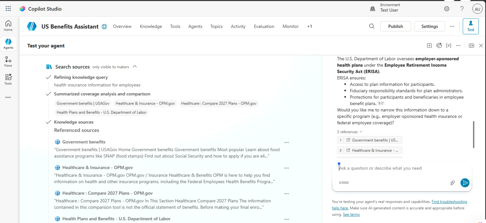

1. Close the **Test** pane.

### Task 2.7 – Publish the agent to the Demo website

1. In the action bar of the agent, select the **Publish** button and select **Publish** again.

1. Select the **Channels** tab.

   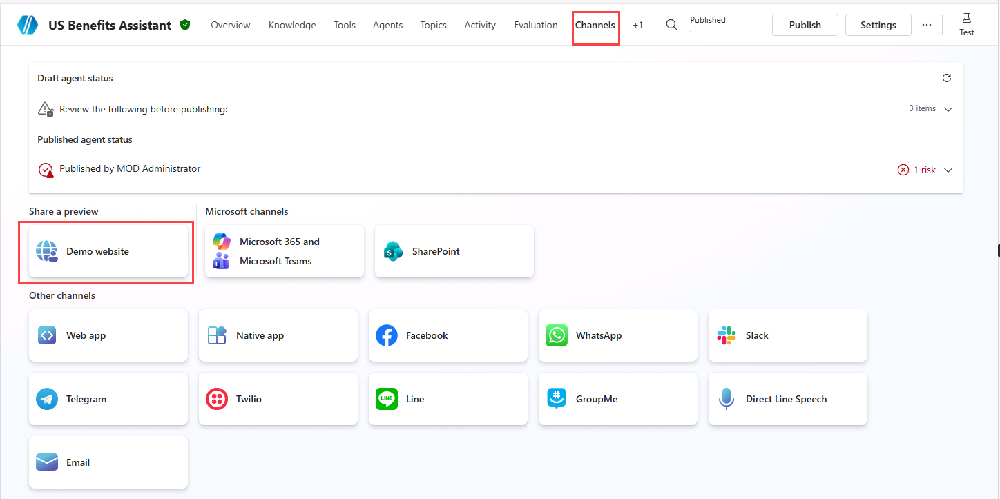

1. Select the **Demo website** channel. This channel is useful for quickly testing and previewing your agent experience.

1. In the **Demo Website** pane, enter the following settings:

   - **Welcome message**: `Ask me about government benefit programs`
   - **Conversation starters**:

      ```prompt
      "Hello"
      "What programs am I entitled to?"
      "What is social security?"
      ```

1. Select **Save**.

1. Select **Open demo website**.

1. Enter the following prompt:

   ```prompt
   What welfare and assistance can I claim for?
   ```

   The response should reference information from the configured knowledge source and may include citations or source references.
   
   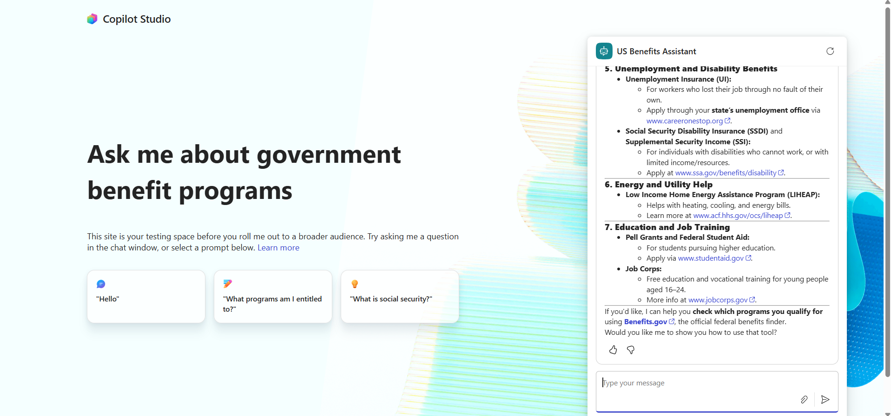

1. Try a few more questions and view the responses from your agent. It will have limited functionality, but should be able to provide relevant answers to questions about benefits.

## Summary
In this exercise, you created agents using templates and natural language, defined their behavior through instructions, and configured a public website as a knowledge source. You also published and tested an agent using the Demo website.

You will build on these concepts in the upcoming labs by exploring topics, knowledge, tools, and other Copilot Studio capabilities to further control and extend agent behavior.